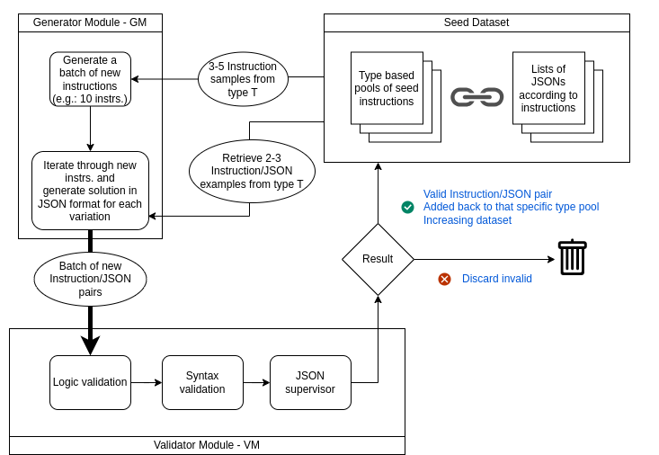

# DatasetSpinner

**DatasetSpinner** is a modular, agent-based synthetic dataset generation pipeline, consisting of two main modules:  
- **GenerationModule (GM)**  
- **ValidatorModule (VM)**  

The purpose of this pipeline is to generate a training dataset for instruction decomposition in the context of **outdoor mobile robot navigation**.



---

## Modules

Each module contains agents, and each agent can be configured independently using different **system prompts** and by choosing **other models** for agents.  
Currently, the pipeline utilizes **OpenAI API models**.

---

### 1. GeneratorModule (GM)

#### 1.1 Instruction generator agent
File: [`gm_instruction_generator.py`](./gm_instruction_generator.py)  
- Selects instructions only from **Seed Dataset**  
- Chooses **3–5 instruction samples** of a given complexity (*easy, medium, hard*) from the seed pool  
- Generates a batch of new instructions similar to the chosen ones  

#### 1.2 JSON generator agent
File: [`gm_json_generator.py`](./gm_json_generator.py)  
- Takes newly generated instructions and retrieves **2–3 Instruction/JSON pairs** from the **Seed Dataset**  
- Converts each newly generated instruction into a list of **atomic actions in JSON format**  

---

### 2. ValidatorModule (VM)

#### 2.1 Logic validator agent
File: [`vm_logic_validator.py`](./vm_logic_validator.py)  
- Takes the newly generated batch of **Instruction/JSON pairs**  
- Validates logical structure of JSONs corresponding to instructions  
- Attempts to fix logical errors (if any)  

#### 2.2 Syntax validator agent
File: [`vm_syntax_validator.py`](./vm_syntax_validator.py)  
- Takes the logically correct batch of Instruction/JSON pairs from the previous agent  
- Attempts to fix syntax errors (if any)  

#### ~~2.3 Supervisor agent  (currently disabled)~~  
File: [`vm_supervisor.py`](./vm_supervisor.py)
- Not used, because it discarded many valid pairs (**too many false negatives**)  
- Could be extended for **additional validation**, e.g., checking how the LLM interprets **quantity of objects in JSONs**  

---

## How it works

1. Multiple **LLM agents** generate new instructions similar to the existing ones.  
2. JSONs are generated for these new instructions.  
3. Validated **Instruction/JSON pairs** are added back to the **Seed Dataset** to increase dataset size.  
4. In the next generation cycle, the newly created pairs are also reused.  

---

## Dataset

The dataset consists of **Instruction/JSON pairs**.

### Example (Hard)

```json
{
    "instruction": "Go to the supply depot and collect 10 power units. Distribute them evenly among charging station 1, charging station 2 and charging station 3. Once all power units are placed, return to the monitoring center.",
    "json": {
        "instruction": [
            {
                "action": "go_to",
                "location": "supply depot",
                "object": null,
                "duration": null
            },
            {
                "action": "wait_for_payload_ready",
                "location": "supply depot",
                "object": [
                    {
                        "description": "power units",
                        "num": "10"
                    }
                ],
                "duration": null
            },
            {
                "action": "go_to",
                "location": "charging station 1",
                "object": null,
                "duration": null
            },
            {
                "action": "wait_for_payload_removal",
                "location": "charging station 1",
                "object": [
                    {
                        "description": "power units",
                        "num": "3"
                    }
                ],
                "duration": null
            },
            {
                "action": "go_to",
                "location": "charging station 2",
                "object": null,
                "duration": null
            },
            {
                "action": "wait_for_payload_removal",
                "location": "charging station 2",
                "object": [
                    {
                        "description": "power units",
                        "num": "3"
                    }
                ],
                "duration": null
            },
            {
                "action": "go_to",
                "location": "charging station 3",
                "object": null,
                "duration": null
            },
            {
                "action": "wait_for_payload_removal",
                "location": "charging station 3",
                "object": [
                    {
                        "description": "power units",
                        "num": "4"
                    }
                ],
                "duration": null
            },
            {
                "action": "go_to",
                "location": "monitoring center",
                "object": null,
                "duration": null
            }
        ]
    }
}
